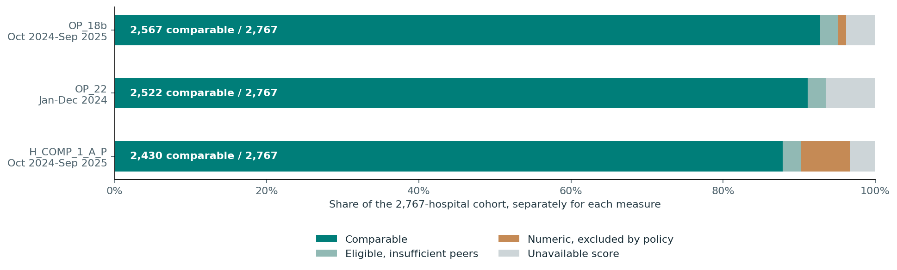
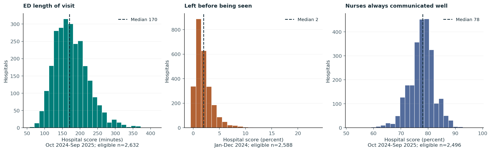

# Healthcare Operations & Performance Analytics

**Official CMS data ? PySpark integration ? exact Spark SQL peer benchmarks ? a reproducible analytical report.**

[**Read the visual report ?**](https://ransij.github.io/healthcare-operations-analytics/) ? [Executive summary](docs/executive_summary.md) ? [Source dictionary](docs/data_dictionary.md) ? [Validation evidence](docs/quality_checks.md)

A bounded healthcare analytics portfolio project covering **2,767 U.S. acute care hospitals with emergency services**. It connects source integrity, explicit eligibility rules and hospital-level peer comparisons to cautious operational decisions.

The published deliverable is a **static HTML report with Python/matplotlib figures**. The PySpark pipeline was executed and validated locally in Phase 2. This portfolio report uses its verified existing exports; it does not rerun the pipeline. Databricks account execution and Power BI are postponed.



## Business problem

**Which hospitals warrant a closer operational or inpatient-communication review relative to eligible hospitals of the same type in the same state?**

An operations analyst needs to distinguish unfavorable relative signals from missing data, incomplete reporting and inadequate peer groups. The intended output is a shortlist for further investigation using current local evidence. It is not a clinical-quality ranking, treatment recommendation or causal model.

## Technologies

- **PySpark:** explicit string schemas, type/date validation, missing-value states, multi-code footnotes, source integration and analytical modeling.
- **Spark SQL:** CTEs, joins, window counts and exact continuous leave-one-out percentiles.
- **Python + matplotlib:** descriptive statistics, four figure groups and a self-contained HTML report. No web framework or JavaScript application.
- **unittest + SHA-256:** quality contracts, independent percentile checks, export integrity and report safeguards.
- **GitHub Pages:** serves the same static report committed in `docs/index.html`.

The validated local pipeline used Python 3.11.16, Spark 4.0.1 and Java 17. The report has a separate, pinned matplotlib environment and requires neither Spark nor Java. NumPy and Pillow are matplotlib dependencies; no additional analytical or web framework is introduced.

## Data sources

Exactly three official CMS analytical datasets are pinned to the release **2026-08-13**. Original CSV bytes remain outside Git.

| Source | Selected information | Measurement period |
|---|---|---|
| [Hospital General Information](https://data.cms.gov/provider-data/dataset/xubh-q36u) | Facility identity, state, type, ownership, emergency services | Snapshot attributes |
| [Timely and Effective Care ? Hospital](https://data.cms.gov/provider-data/dataset/yv7e-xc69) | `OP_18b`: ED visit median minutes; excludes transfers and psychiatric/mental-health cases | Oct 2024?Sep 2025 |
| Same Timely and Effective Care source | `OP_22`: published percent leaving before being seen | Jan?Dec 2024 |
| [Patient survey (HCAHPS) ? Hospital](https://data.cms.gov/provider-data/dataset/dgck-syfz) | `H_COMP_1_A_P`: percent reporting nurses always communicated well during an inpatient stay | Oct 2024?Sep 2025 |

The two ED measures are lower-favorable; nurse communication is higher-favorable. HCAHPS is inpatient experience, not ED satisfaction. See the [dictionary](docs/data_dictionary.md) for exact resources, hashes, source fields and notes.

## Methodology

1. **Pin and verify.** Check all three original SHA-256 hashes before Spark reads the files. Preserve facility IDs as text and retain raw strings, dates, samples and footnotes.
2. **Define the population.** Acute Care Hospitals, emergency services available, 50 states plus DC. The model retains 5,419 hospitals and 14,106 selected measure records, including records outside the analytical cohort.
3. **Apply measure-specific eligibility.** Preserve missing values rather than filling with zero. Exclude incomplete-period/cautionary results as specified. OP_22 permits a sample-based submission note. HCAHPS requires at least 100 completed surveys and blank score, sample and response-rate notes.
4. **Compare like with like.** Match state, hospital type, measure, dataset, release and exact start/end dates. Exclude the evaluated facility by ID before calculating exact continuous Q1, median and Q3. Require at least **10 other eligible hospitals**. Ownership is descriptive, not a peer partition.
5. **Assign bounded review signals.** Strictly above peer Q3 for the ED measures, or below peer Q1 for nurse communication. Ineligible/sparse-peer records receive null reference values and signals. Equal-valued other hospitals remain peers.
6. **Report existing results.** Verify the latest successful run's `SUCCESS.json`, its quality-report hash and all five CSV hashes before any descriptive analysis. Analyze eligible hospital scores and existing peer gaps without changing original outputs.

The median across published hospital medians is a benchmark of hospitals, not a pooled patient median. Published percentages stay on a 0?100 scale; differences between percentages are percentage points. Measurement periods and patient populations are never pooled into an overall score.

## Results

Calculated from successful run **`20261031T100805Z_d4fac535`**. Each measure starts from the same 2,767-hospital population; eligibility and peer availability differ.

| Indicator | Eligible hospitals | Median across eligible hospitals | Hospital IQR | Comparable hospitals | Review flags / comparable |
|---|---:|---:|---:|---:|---:|
| ED visit duration (`OP_18b`) | 2,632 (95.12%) | 170 minutes | 140?204 minutes | 2,567 | 659 / 2,567 (25.7%) |
| Left before being seen (`OP_22`) | 2,588 (93.53%) | 2% | 1?3% | 2,522 | 493 / 2,522 (19.5%) |
| Nurses always communicated well | 2,496 (90.21%) | 78% | 75?81% | 2,430 | 541 / 2,430 (22.3%) |

- **Coverage changes the decision set.** Notes/sample rules exclude 181 additional numeric HCAHPS scores and 30 OP_18b scores. Across the three measures, 197 eligible hospital?measure records lack ten other peers.
- **Ties matter.** 338 eligible hospitals report 0% left before being seen. Rounded percentages and strict quartile thresholds help explain why flag shares do not mechanically equal 25%.
- **Local context is essential.** The report illustrates one hospital selected by the lowest facility ID comparable on all three measures, independent of its scores. Its ED duration is 59 minutes above its own peer median; its other two indicators do not cross the unfavorable quartile threshold. This is an illustration, not an overall clinical-quality assessment.

Possible actions are to request current arrival, staffing, workflow and survey-comment evidence, review ED operations and inpatient communication separately, and improve evidence before judging hospitals with incomplete or sparse-peer data. No causal effect, significance test or business impact estimate is claimed.

## Data quality and validation

| Evidence | Actually executed |
|---|---|
| Phase 2 pipeline tests | 27 passing tests, previously recorded; not rerun for this report |
| Independent peer check | All 8,301 result rows and 22,557 comparable-case percentile values verified in Phase 2 |
| Source-to-model check | 14,106 selected records independently reconciled with original CSVs |
| Pipeline reproducibility | Two prior complete runs with identical business fields |
| Report input verification | Latest SUCCESS ? quality-report hash ? five export hashes and row counts verified before use |
| Report-specific tests | 8 passing tests: hash corruption, missing exports, source scope, quantiles and summary-only safeguards |

The validated model had no duplicate selected keys or orphan hospitals. Excluded/missing records remain traceable. Evidence distinguishes previous Spark execution from the current report-only work.

See [pipeline checks](docs/quality_checks.md), [report validation](docs/report_validation.md), [calculated statistics](docs/evidence/analysis_summary.json), and [report source/artifact hashes](docs/evidence/report_source_verification.json).

## Visual report

[**Open the published HTML report**](https://ransij.github.io/healthcare-operations-analytics/) or download [the self-contained HTML](https://raw.githubusercontent.com/RansiJ/healthcare-operations-analytics/main/docs/index.html) and open it locally. The HTML embeds its figures, so it works offline. Charts and tables can scroll horizontally on narrow screens.

The report contains coverage, eligible-score distributions, leave-one-out peer-gap distributions and an explicitly selected hospital example. Every panel identifies its measure, unit, period and sample size. Peer IQR bands are not confidence intervals.



## Reproducibility

To rebuild **only the report** from existing analytical exports, start in the repository root. This requires matplotlib, not PySpark or Java:

```powershell
uv venv "$env:LOCALAPPDATA\healthcare-report-venv" --python 3.11
uv pip install --python "$env:LOCALAPPDATA\healthcare-report-venv\Scripts\python.exe" --link-mode copy -r requirements-report.txt
$reportPython = "$env:LOCALAPPDATA\healthcare-report-venv\Scripts\python.exe"
& $reportPython -m analysis.build_report --run-dir 'C:\path\to\successful-run' --report-date 2026-10-31
& $reportPython -m unittest discover -s tests -p test_report.py -v
```

Without `--run-dir`, the builder selects the latest `SUCCESS.json` directory under `~/.local/share/healthcare-operations-analytics/runs/`. It validates hashes before use and writes only report artifacts. A corrupted export stops the build. If full exports are unavailable, it uses only the existing evidence counts and explicitly omits distributions and hospital examples; `--summary-only` selects this limited mode deliberately.

Full exports are not committed. A third party can inspect the published report immediately and reproduce its reported aggregate values from the included small evidence files. Reproducing every distribution requires the original pipeline's pinned inputs and a successful full run. The [local reproduction guide](docs/reproducibility.md) preserves the commands for that separate future task. The pipeline was **not** rerun to produce this portfolio version.

```text
analysis/build_report.py       Report-only integrity checks, statistics, figures and HTML
healthcare_pipeline/           Original PySpark pipeline, source registry and audit oracle
sql/                          Original Spark SQL integration and exact peer benchmarks
tests/                        Original pipeline tests plus separate report tests
docs/index.html               Published, self-contained visual report
docs/figures/                 Four actual matplotlib figures
docs/executive_summary.md      Brief executive interpretation
docs/evidence/                Small verified quality/report evidence; no raw CSVs
requirements.txt              Original local Spark dependencies
requirements-report.txt       Pinned report-only dependencies
```

## Limitations

- The snapshot describes historical measurement periods; it does not monitor current hospital conditions. OP_22 covers a different interval from the other two measures.
- Same-state/type peers are not adjusted for size, case mix, staffing, rurality or teaching status. Hospital attributes are snapshot attributes.
- Missingness, survey nonresponse, small samples and reporting exceptions may be selective. Eligibility changes the population behind each result.
- Quartile flags are relative review rules, not clinical-quality diagnoses. Rounded scores and ties affect flag rates. There is no arbitrary composite quality index, patient-level inference or causal claim.
- Databricks account execution and a Power BI dashboard are explicitly **postponed**. No Snowflake, dbt, Streamlit or machine learning is included.
